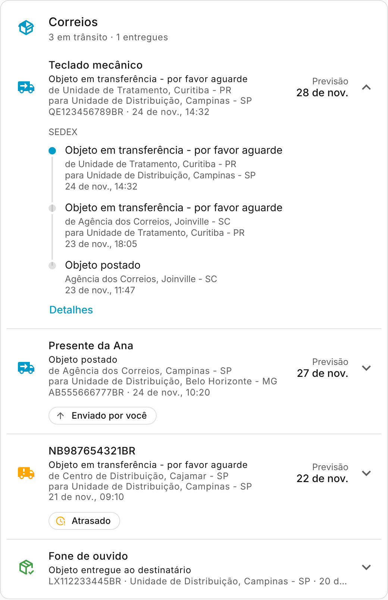

# Correios

<!-- ha-marketplace:exclude-start -->
[](https://github.com/roquerodrigo/ha-correios/actions/workflows/ci.yml)
[](https://github.com/roquerodrigo/ha-correios/releases/latest)
[](https://github.com/sponsors/roquerodrigo)

[](https://my.home-assistant.io/redirect/hacs_repository/?owner=roquerodrigo&repository=ha-correios&category=integration)
<!-- ha-marketplace:exclude-end -->

Acompanhe no Home Assistant todos os pacotes dos Correios ligados ao seu CPF
ou CNPJ, sem digitar nenhum código de rastreamento. Você vê onde cada pacote
está, quando ele deve chegar e pode ser avisado quando ele se movimenta. Os
dados vêm do site de rastreamento dos Correios, acessado com a mesma conta
que você usa no site e no aplicativo.



## Recursos

- Veja os pacotes que estão vindo para você e os que você enviou, logo que
  aparecem no site dos Correios.
- Acompanhe o status mais recente de cada pacote, onde ele está, para onde
  segue e o histórico completo de rastreamento.
- Saiba quantos pacotes estão a caminho e em que dia chega o próximo.
- Receba uma notificação quando um pacote novo aparece, muda de status ou é
  entregue.
- Adicione ao dashboard um card com todos os pacotes, que já vem instalado
  com a integração.
- Pacotes entregues saem do Home Assistant sozinhos depois do número de dias
  que você escolher.

## Requisitos

- Home Assistant 2026.10.4 ou mais recente.
- Uma conta dos Correios, com o mesmo usuário e a mesma senha do site e do
  aplicativo. O usuário pode ser um CPF, um CNPJ ou um idCorreios.
- Acesso do Home Assistant à internet.

<!-- ha-marketplace:exclude-start -->
## Instalação

### Marketplace do Home Assistant (recomendado)

1. Selecione o botão **Open your Home Assistant instance** acima, ou vá em
   **Configurações → Marketplace**, selecione **Adicionar a partir de link** no
   canto superior direito, informe `roquerodrigo/ha-correios` no campo
   **Link do GitHub** e selecione **Adicionar**.
2. Selecione **Instalar**.
3. Reinicie o Home Assistant.

O Marketplace vem com o Home Assistant 2026.11 e versões posteriores. Nas
versões anteriores, adicione este repositório ao HACS como repositório
personalizado do tipo **Integração** e instale a partir de lá.

### Manual

1. Baixe o `correios.zip` da
   [última release](https://github.com/roquerodrigo/ha-correios/releases/latest).
2. Extraia o conteúdo em `config/custom_components/correios/`.
3. Reinicie o Home Assistant.
<!-- ha-marketplace:exclude-end -->

## Configuração

Vá em **Configurações → Dispositivos e serviços → Adicionar integração**,
procure **Correios** e preencha o formulário.

| Campo                             | O que informar                                      |
|-----------------------------------|-----------------------------------------------------|
| Usuário (CPF, CNPJ ou idCorreios) | O usuário com que você entra no site dos Correios   |
| Senha                             | A senha da sua conta dos Correios                   |

Cada conta aparece como um dispositivo chamado **Correios** seguido do
usuário. Um CPF aparece mascarado, por exemplo `Correios ***.456.789-**`.
Para acompanhar mais de uma conta, adicione a integração de novo com o outro
usuário.

Se você trocar a senha no site dos Correios, o Home Assistant pede a nova.
Para atualizá-la antes disso, abra a integração e selecione
**Reconfigurar**. Nos dois casos, informe o mesmo usuário da configuração
original: outra conta é recusada.

## Opções

Abra a integração e selecione **Configurar**.

| Opção                                | Padrão | Faixa            | Efeito                                                  |
|--------------------------------------|--------|------------------|---------------------------------------------------------|
| Intervalo de consulta (segundos)     | 900    | 300 ou mais      | De quanto em quanto tempo a lista de pacotes é lida     |
| Manter pacotes entregues por (dias)  | 7      | de 0 a 90        | Por quanto tempo um pacote entregue continua aparecendo |

Os dias contam a partir da entrega. Com 0, o pacote sai do Home Assistant
assim que é entregue, e o evento **Entregue** não chega a ser disparado.

## Entidades

### Conta

| Entidade                     | Plataforma | Mostra                                                         |
|------------------------------|------------|----------------------------------------------------------------|
| Pacotes em trânsito          | Sensor     | Quantos pacotes estão vindo para você                          |
| Pacotes enviados em trânsito | Sensor     | Quantos pacotes que você enviou ainda não foram entregues      |
| Próxima entrega              | Sensor     | O dia previsto para o próximo pacote que vem para você chegar  |
| Atualização de pacote        | Evento     | Novo pacote, Status alterado ou Entregue (veja Eventos abaixo) |

Os dois sensores de contagem trazem no atributo `tracking_codes` os códigos
dos pacotes contados. A **Próxima entrega** traz no atributo `tracking_code`
qual é o pacote e fica desconhecida quando nenhum pacote a caminho tem
previsão.

### Cada pacote

Cada pacote aparece como um dispositivo chamado `Pacote <código>`, dentro do
dispositivo da conta.

| Entidade            | Plataforma | Mostra                                                        |
|---------------------|------------|---------------------------------------------------------------|
| `Pacote <código>`   | Sensor     | O status mais recente, com o texto dos Correios               |
| Previsão de entrega | Sensor     | O dia previsto para a entrega, desconhecido sem previsão      |
| Número de rastreio  | Sensor     | O código de rastreamento. Diagnóstico                         |

O sensor de status traz estes atributos:

| Atributo                          | Conteúdo                                                        |
|-----------------------------------|-----------------------------------------------------------------|
| `tracking_code`                   | Código de rastreamento                                          |
| `direction`                       | `received` (vindo para você) ou `sent` (enviado por você)       |
| `delivered`, `delayed`            | Se já foi entregue e se os Correios o marcaram como atrasado    |
| `detail`                          | Detalhe do status, quando há                                    |
| `unit`, `location`                | Onde o pacote está, por exemplo `Unidade de Tratamento` em `Sao Paulo - SP` |
| `destination_unit`, `destination` | Para onde ele segue, durante uma transferência                  |
| `category`                        | Tipo de envio                                                   |
| `expected_delivery`               | Data prevista de entrega                                        |
| `last_event_at`                   | Data e hora do último evento                                    |
| `events`                          | Histórico completo, do mais recente para o mais antigo          |

Cada item de `events` tem `description`, `detail`, `occurred_at`, `unit`,
`location`, `destination_unit` e `destination`. O atributo `events` não é
gravado no banco de dados do Home Assistant, para não ocupar espaço.

Um pacote novo ganha o próprio dispositivo assim que aparece no site dos
Correios, sem reiniciar nada. O dispositivo é removido quando o pacote passa
do prazo definido em **Manter pacotes entregues por**, ou quando some do site
dos Correios por mais de uma hora.

## Eventos

A entidade **Atualização de pacote** dispara um evento por pacote a cada
mudança encontrada numa consulta:

| Tipo de evento   | Nome na interface | Quando                                         |
|------------------|-------------------|------------------------------------------------|
| `new_package`    | Novo pacote       | Um pacote passou a aparecer na sua conta       |
| `status_changed` | Status alterado   | O pacote ganhou um novo evento de rastreamento |
| `delivered`      | Entregue          | O pacote foi entregue                          |

Cada evento traz os atributos `tracking_code`, `direction`, `status`,
`detail`, `unit`, `location`, `destination_unit`, `destination` e
`expected_delivery` do pacote. Nada é disparado na primeira consulta depois
que o Home Assistant inicia ou a integração é recarregada, então reiniciar não
repete avisos antigos. Mudanças que acontecem com o Home Assistant desligado
não são anunciadas.

Esta automação manda uma notificação a cada atualização. Troque
`event.correios_456_789_package_update` pelo ID da entidade
**Atualização de pacote** da sua conta.

```yaml
automation:
  - alias: Correios - atualização de pacote
    triggers:
      - trigger: state
        entity_id: event.correios_456_789_package_update
        not_from: unavailable
    actions:
      - action: notify.notify
        data:
          title: "Correios {{ trigger.to_state.attributes.tracking_code }}"
          message: >-
            {{ trigger.to_state.attributes.status }}
            ({{ trigger.to_state.attributes.location }})
```

Para ser avisado só das entregas, adicione uma condição de template com
`{{ trigger.to_state.attributes.event_type == 'delivered' }}`.

## Card de dashboard

O card vem com a integração e é adicionado aos recursos do dashboard
sozinho. Procure **Correios** no seletor de cards de qualquer dashboard e
ajuste as opções no editor visual. Em YAML:

```yaml
type: custom:correios-card
```

O card lista primeiro os pacotes em trânsito, do movimento mais recente para
o mais antigo, e mostra a previsão de entrega e os atrasos. Tocar num pacote
abre o histórico de rastreamento. Se você renomear o sensor de um pacote no
Home Assistant, por exemplo para "Teclado mecânico", o card mostra esse nome
com o código logo abaixo. Pacotes cujo sensor está oculto não aparecem.

| Opção            | Aceita                | Padrão     | Efeito                                                                   |
|------------------|-----------------------|------------|--------------------------------------------------------------------------|
| `title`          | Texto                 | `Correios` | Título do card                                                           |
| `show_delivered` | `true` ou `false`     | `true`     | Mostra os pacotes entregues que ainda aparecem no Home Assistant          |
| `show_sent`      | `true` ou `false`     | `true`     | Mostra os pacotes que você enviou                                        |
| `show_history`   | `true` ou `false`     | `true`     | Com `false`, tocar num pacote abre a janela de detalhes da entidade      |
| `max_events`     | Número, de 1 a 50     | `10`       | Quantos eventos do histórico aparecem                                    |

O card está disponível em português e em inglês.

Se os recursos dos seus dashboards são gerenciados em YAML, a integração não
consegue adicioná-lo como recurso e carrega o card de outra forma. Ele
continua disponível no seletor de cards.

## Como funciona

A integração entra no site de rastreamento dos Correios com a sua conta e lê
a mesma lista de pacotes que o site mostra para o seu CPF ou CNPJ. A consulta
se repete no intervalo definido nas opções, 15 minutos por padrão. Quando a
sessão no site expira, a integração entra de novo sozinha.

O site dos Correios tem quedas curtas e frequentes. Se uma consulta falha, as
entidades mantêm os últimos dados por até uma hora antes de ficarem
indisponíveis. Do mesmo jeito, um pacote que some da lista por menos de uma
hora continua no Home Assistant, e a volta dele não é anunciada como pacote
novo.

Status, detalhes e locais aparecem exatamente como os Correios os escrevem.

## Solução de problemas

**A configuração diz que o usuário ou a senha estão incorretos.** Confira se
você consegue entrar no site de rastreamento dos Correios com os mesmos
dados.

**A configuração mostra um erro desconhecido.** Uma causa possível é o site
dos Correios pedir um captcha no login, que a integração não consegue
resolver. Tente de novo mais tarde.

**Um pacote que aparece no site não aparece no Home Assistant.** Espere a
próxima consulta, que acontece a cada 15 minutos por padrão. Pacotes
entregues há mais tempo do que a opção **Manter pacotes entregues por** não
aparecem.

**Não consigo excluir o dispositivo de um pacote.** A conta e os pacotes
ainda acompanhados não podem ser excluídos. Os pacotes entregues saem
sozinhos depois do prazo definido nas opções.

**Outro problema.** Baixe os diagnósticos no menu da integração e anexe-os a
uma [issue](https://github.com/roquerodrigo/ha-correios/issues). O arquivo não
traz o usuário, a senha nem os códigos de rastreamento.

## Limitações conhecidas

- Este projeto não tem vínculo com os Correios. Ele depende do site público de
  rastreamento, que pode mudar sem aviso.
- Só aparecem os pacotes que o site dos Correios associa ao CPF ou CNPJ da
  conta. Não é possível acompanhar um código de rastreamento avulso.

## Apoie o projeto

Esta integração é desenvolvida e mantida no meu tempo livre. Se ela for
útil para você, considere
[patrocinar o trabalho](https://github.com/sponsors/roquerodrigo). É o que
garante as correções, os testes e as novas versões.

Bugs e sugestões: abra uma [issue](https://github.com/roquerodrigo/ha-correios/issues).

<!-- ha-marketplace:exclude-start -->
## Contribuindo

Veja o [CONTRIBUTING.md](CONTRIBUTING.md) para o ambiente de desenvolvimento e
o fluxo de trabalho, e o [CODE_STYLE.md](CODE_STYLE.md) para as convenções de
código.

## Licença

[MIT](LICENSE)
<!-- ha-marketplace:exclude-end -->
